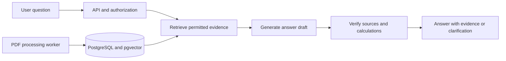

# Financial Document Intelligence

**Ask financial questions. Trace the evidence. Understand the numbers.**

Financial Document Intelligence is a project designed to make financial PDF reports easier to explore through natural-language questions, verifiable sources, and transparent calculations.

It combines **Retrieval-Augmented Generation (RAG)**—finding relevant document content before generating an answer—with a focus on financial tables, numerical accuracy, and organization-level access control.

## 📌 Problem Statement

**A financial answer is only useful when its numbers and sources can be checked.** Annual reports contain valuable information, but finding the right figure often means navigating long PDFs, comparing multiple reporting periods, and interpreting tables with different units.

A number can lose its meaning when separated from its row label or year. An AI-generated answer can sound convincing without enough supporting evidence. In a shared workspace, even a correct answer is inappropriate if it uses a document the user is not allowed to read.

This project explores how document retrieval, evidence validation, deterministic calculations, and access control can work together to address these problems.

## ⭐ Key Features

The features below describe the intended product experience and guide the system design.

### 1. Financial Document Q&A

- **Natural-Language Questions**

  Ask about revenue, earnings, cash flow, and other figures in English annual reports.

- **Table-Aware Retrieval**

  Preserve row labels, reporting periods, and units so that retrieved numbers retain their financial context.

- **Source References**

  Connect answers to the original document and page, allowing users to inspect the supporting evidence.

### 2. Transparent Numerical Analysis

- **Period Comparisons**

  Compare figures across two fiscal periods while checking that their currencies, units, and definitions are compatible.

- **Reproducible Calculations**

  Use Python Decimal for supported differences, growth rates, and ratios, with rounding applied at the final display step.

- **Visible Calculation Details**

  Present the input values, units, formula, and source for each calculation.

### 3. Evidence-Based Responses

- **Insufficient-Evidence Handling**

  Abstain when the available documents do not support an answer.

- **Clarifying Questions**

  Ask for missing details when the company, fiscal year, or financial metric is ambiguous.

- **Answer Verification**

  Check citations and numerical claims against retrieved evidence before returning a response.

### 4. Organization & Document Permissions

- **Organization Isolation**

  Limit document access to authorized members of the relevant organization.

- **Document-Level Access**

  Support organization-wide documents and restricted documents shared with specific members.

- **API & Database Checks**

  Combine application authorization with PostgreSQL Row-Level Security (RLS) to enforce access rules.

## 💬 Example Questions

> “What were the company's total revenues in fiscal year 2024?”
>
> “How much did operating cash flow change between 2023 and 2024?”
>
> “What was the revenue growth rate, and which figures were used to calculate it?”

The goal is to make both the answer and the reasoning behind its numbers easy to inspect.

## 🖥️ Tech Stack

Technologies selected for the target architecture:

### 🌐 Frontend

A web interface for document management, questions, and evidence inspection.

### 🛠️ Backend & Database

API request handling, document permissions, metadata storage, and keyword/vector retrieval.

### 📄 Document Processing & Calculations

PDF text, table, and coordinate extraction, with decimal arithmetic for financial calculations.

### ⚙️ Development & Testing

Reproducible local environments and automated regression checks.

## 🧩 System Design

The intended flow keeps authorization ahead of retrieval and verification ahead of the final answer.

## 🔬 Evaluation Approach

The evaluation design compares a basic RAG baseline with focused changes to table handling, retrieval, answer verification, and calculation.

- **Retrieval:** Can the system find all the evidence needed to answer a question?
- **Grounding:** Do the cited sources actually support the answer?
- **Numerical accuracy:** Are the values, periods, units, and calculations correct?
- **Coverage:** How often does the system answer, and when does it unnecessarily abstain?
- **Access control:** Can unauthorized documents appear in results or responses?

Improvements are evaluated under comparable document, permission, and context-budget conditions. Measured results and limitations are documented separately from design goals.

## 📚 Data & Scope

Public English annual-report PDFs are assigned to fictional organizations for development and evaluation. This project does not represent the operation of a service using real internal company documents.

The scope covers financial lookups, two-period comparisons, growth rates, ratios, and supporting evidence. Scanned-document OCR, stock-price prediction, investment recommendations, real-time market data, and model training are outside the scope.

Original PDFs, extracted full text, local databases, and credentials are excluded from Git. Document URLs and version hashes are recorded in the [source manifest](eval/manifests/s1_reports.json); public availability is not treated as permission to redistribute a report.

## 🚀 Getting Started

See the [local development guide](docs/DEVELOPMENT.md) for environment setup, database migrations, API commands, and tests.

## 📖 Documentation

| Guide | What it covers |
|---|---|
| [Architecture](docs/ARCHITECTURE.md) | System boundaries, data flow, and access policies |
| [Design Decisions](docs/DECISIONS_AND_INTERVIEW.md) | Alternatives, trade-offs, and validation methods |
| [Evaluation Guide](eval/README.md) | Dataset authoring and experiment rules |
| [Development Plan](docs/IMPLEMENTATION_PLAN.md) | Implementation scope and acceptance criteria |
| [Engineering Log](docs/PROGRESS.md) | Implementation details, verified results, and limitations |

Supporting engineering documents are maintained in Korean.
